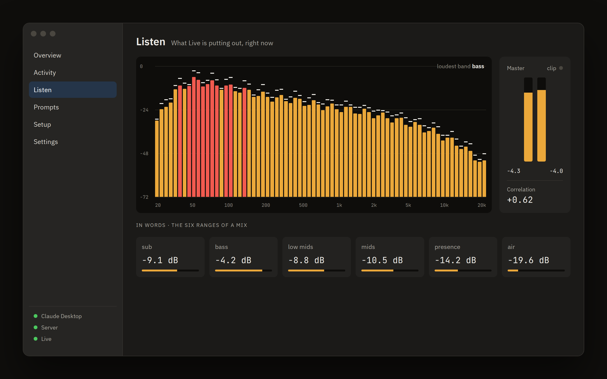

# The Mac app

A menu bar app, Tauri 2, linked against the server's own crate.

- **The chain.** Client, server, Live: one state each, one fix each. The app never runs the server your client talks to; it makes that invisible process visible, and warns when two are talking to Live.
- **Prompts.** Four finished prompts for the four states you open the app in: make a song from nothing, prepare a set you can perform, finish what you already have, build around your sample. Copy one, paste it into Claude, and it asks you what to make before it writes a note — then keeps refining until you say the mix is done, or keeps writing the next section while the current one plays. They are plain markdown in [`prompts/`](../prompts/), so you can read and paste them without the app; nothing is sent anywhere when you copy.
- **Activity.** Every tool call with its Live round-trip, the commands it sent, the result, and an estimated token cost, from the server's local log. Payloads (your MIDI and names) are shown only if you turned them on.
- **Listen.** What Live is putting out right now, through a macOS process tap of Live's process alone: no virtual audio driver, no routing change, Live keeps playing through its own output. A spectrum from 20 Hz to 20 kHz in dBFS with peak hold, master meters with a clip light, correlation, and the six ranges of a mix as their share of the whole. A small always-on-top window keeps it beside Live. The audio is analysed in memory about thirty times a second and thrown away. macOS 14.4 or later for this screen; the rest of the app runs on macOS 12.
- **Remember what Live plays** (Settings, off until you turn it on). The tap keeps running while the app is open and Live plays, with no window needed, and each bar is measured and kept for Claude to read: loudness, peaks, the six ranges, a 16th-note RMS for the duck, a spectrum and a twelve-note profile thirty times a second — stamped with the bar, the section and the set's revision. Measurements are written, audio is not (about 3 KB a second); kept 30 days. The menu bar shows a dot while it remembers.
- **Feedback.** The song as a strip of sections under the loudness of each bar as it was last heard: blue heard since the last change, orange heard before it, grey never heard. Click a bar to comment on it, or press M while Live plays to stamp the bar playing; the **Note float** does the same from a small window over Live. Claude's questions (`offer_options`) are rows with ▶ to hear each option and **This one** to pick it, with a note; its replies land in the comment's thread. **Claude may play the set** lets Claude play the song to measure it while you are away; it turns off when you press play or stop, or after 20 minutes.
- **Visual.** A full-screen feedback visual in the MilkDrop tradition, drawn from the same audio. Eight presets that never show you the same thing twice, because every visit re-rolls the palette, the warp, the shape and the fold, and never cut, because one becomes the next over several seconds on the same trails. Space wanders, 1–8 picks one, F is full screen.

---

[← README](../README.md)
